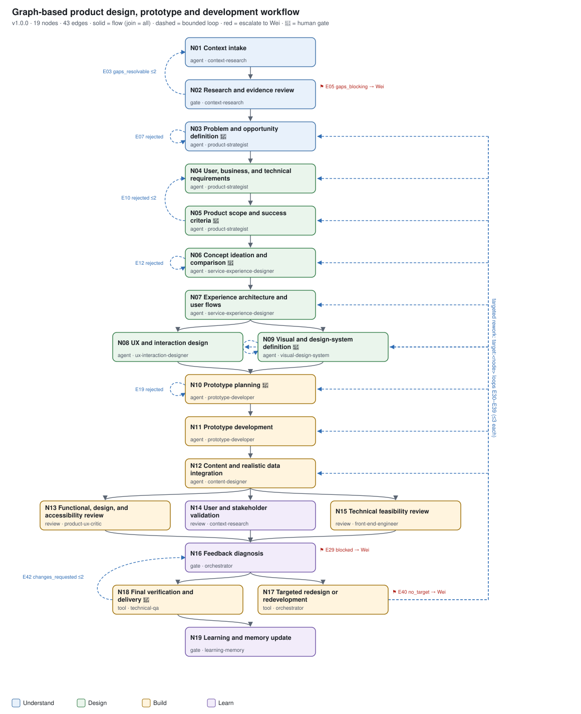

# Prototype Production Graph

**TL;DR:** Turn a product brief into a verified prototype through 19 governed nodes, targeted rework, and six human approval gates.

[](https://github.com/veevia/prototype-production-graph/actions/workflows/test.yml)

Prototype Production Graph (`pdg`) is a local, file-based workflow engine for
**Understand -> Design -> Build -> Learn**. Agents work from task packets; the engine
validates their outputs, applies rubrics, traces defects to their originating nodes,
and records a hash-chained ledger. It does not require an LLM API, cloud service,
Microsoft account, or Wei_workspace checkout.



## Quick start

Requirements: Python 3.11+, Node.js 22+, and Chromium installed through Playwright.
Browser installation needs network access once; the supplied example runs locally.

```bash
git clone https://github.com/veevia/prototype-production-graph.git
cd prototype-production-graph
python3 -m venv .venv
source .venv/bin/activate
python -m pip install -r requirements.txt
python -m playwright install chromium
python -m pdg validate
python -m pdg docs --check
python -m pdg dry-run --out /tmp/pdg-community-demo
python -m pdg ledger-verify /tmp/pdg-community-demo
python -m pdg report /tmp/pdg-community-demo
```

The fictional Lot Release Workbench intentionally fails its first build's review,
then reworks only the affected nodes and passes on build v2. Dry-run approvals are
labelled `dry-run-auto`; simulated sessions are not real user research.
Use a new output directory when repeating the demonstration.

## Use it on your own project

Run commands from this checkout with its virtual environment active:

```bash
python -m pdg init ../my-prototype --name "My prototype"
# Replace ../my-prototype/sources/brief.md with your actual brief; add authorized sources.
# Add your name to `humans: [Your Name]` in ../my-prototype/pdg.project.yaml.
python -m pdg run ../my-prototype
python -m pdg tasks ../my-prototype
python -m pdg status ../my-prototype
```

Give each task packet to your coding assistant or perform it yourself. Write the
declared artifacts and submit using the packet's exact command and dispatch token.
At a human gate, record the named approver's actual decision. No standing delegation
is inherited from the author's workspace. Release, publication, risk acceptance and
rule changes require their own explicit authorization.

The original role cards use **Wei** as the example principal. Your `humans` project
setting authorizes your own named approvers; the name is not an authentication system.
This is a trusted local workflow, not a sandbox for hostile agents.

## What's included

| Directory | Responsibility |
|---|---|
| `pdg/` | Engine, CLI, state, provenance, checks, reports and privacy-policy selection |
| `graph/`, `config/`, `rubrics/` | 19 nodes, 43 edges, 17 bounded loops, 8 subgraphs and 22 rubrics |
| `agents/`, `prompts/` | 13 role cards and 19 task instructions |
| `templates/control/`, `templates/artifacts/` | Eight shared control documents and their referenced artifact templates |
| `knowledge/` | Public quality-rule profile; no customer case studies or trained personal preferences |
| `scoring/` | Bundled dependency-free candidate scoring tool and its tests |
| `examples/coa-review/` | Fictional sources, prototype, fixtures and expected outputs |
| `vendor/axe-core/` | Offline accessibility checker, with its MPL-2.0 license |
| `tests/`, `.github/workflows/` | Regression suite and GitHub Actions checks |

See [architecture](docs/architecture.md), [node catalog](docs/node-catalog.md),
[state model](docs/state-model.md), [control ownership](docs/control-access.md),
[evaluation](docs/evaluation-and-gates.md), and [dependency inventory](docs/dependencies.md).

## Agents, skills and integrations

The graph names 74 skill labels and optional host tools. These are guidance for the
agent executing a packet, not Python imports or automatically installed services.
The packets include node instructions, inputs, schemas, rubrics and submit commands.
You may execute them manually or map the role cards to your own assistant.
WorkIQ, wiki retrieval, Figma, MCP tools and the author's custom agents are optional;
use authorized local sources and your own design system instead.

No proprietary skill collection, Microsoft credentials, customer hub, runtime session,
private transcript, private Git history or personal scoring model is included.
The sample privacy vocabulary is fictional: configure your own identifiers locally
before recording sensitive review data. Static identifier checks are not a privacy guarantee.

## Contributing and updates

Read [CONTRIBUTING.md](CONTRIBUTING.md) for tests, contribution boundaries, and the
workspace-to-community release path. The repository is a source checkout, not a
published PyPI package; run `python -m pdg` from its root.

## Non-goals and limitations

- Not a design generator, agent host, model provider, authentication service or production backend.
- Browser checks and rubric scores do not substitute for real usability research or production readiness.
- Do not publish project sources, ledgers, reviews or credentials with contributions.
- Existing runs may detect changed engine code or rule fingerprints after an upgrade;
  inspect `pdg status` and `pdg recheck-release` rather than bypassing the checks.

Original project code is MIT-licensed; vendored axe-core retains MPL-2.0.
See [LICENSE](LICENSE) and [THIRD_PARTY_NOTICES.md](THIRD_PARTY_NOTICES.md).
